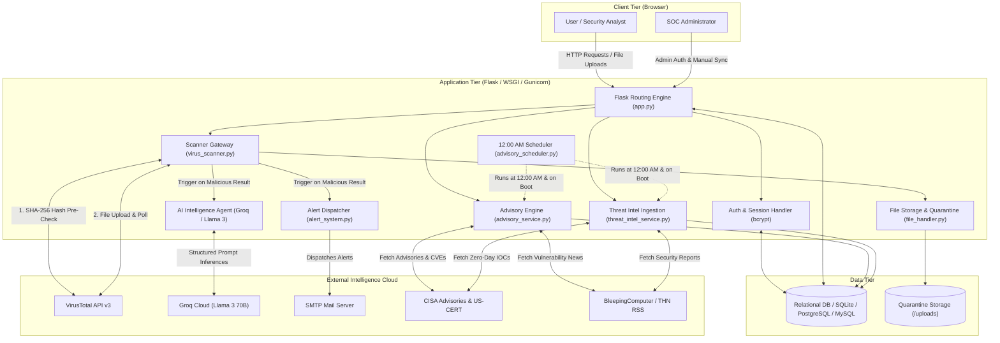
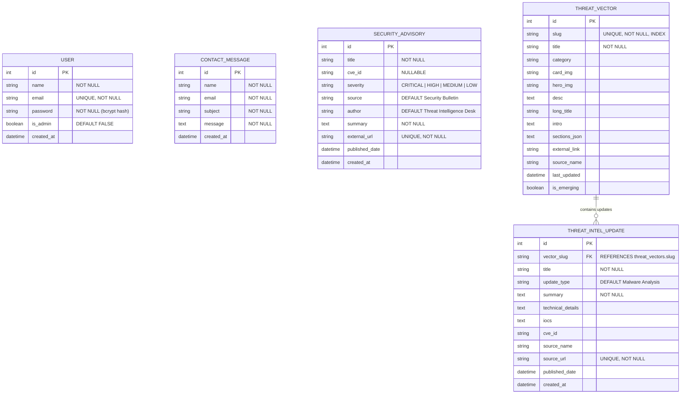
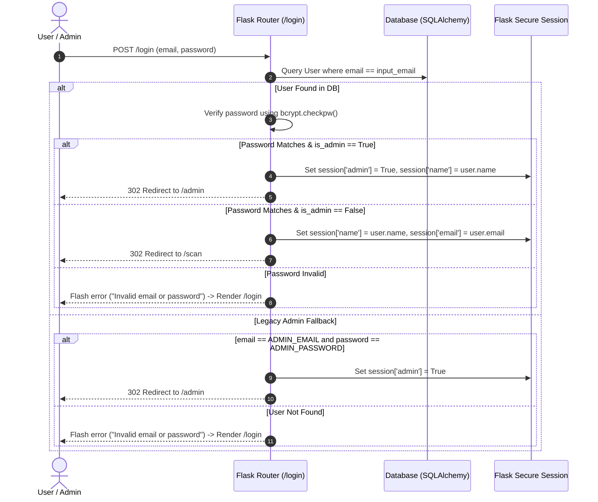
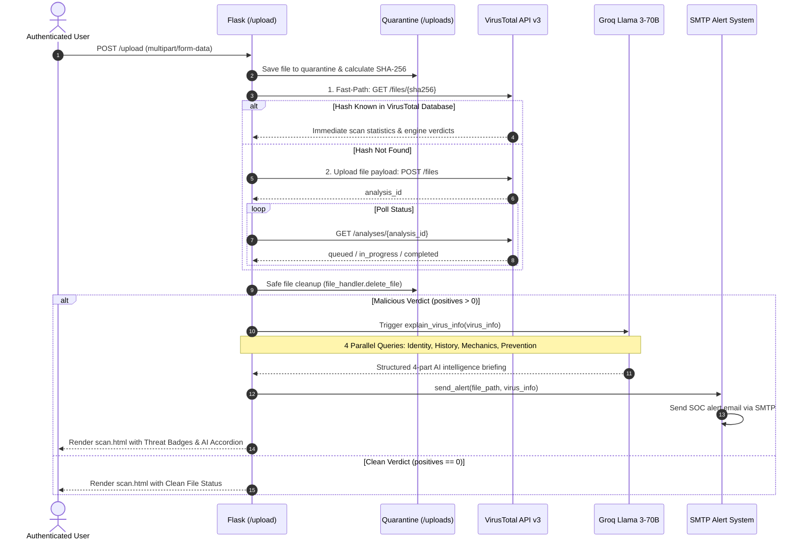

# VirusGuard 🛡️

[](https://www.python.org/)
[](https://flask.palletsprojects.com/)
[](https://www.sqlalchemy.org/)
[](https://groq.com/)
[](https://www.virustotal.com/)
[](tests/)
[](LICENSE)

> **VirusGuard** is an enterprise-grade cybersecurity analysis and threat intelligence platform built with Flask, SQLAlchemy, VirusTotal API v3, Groq-accelerated Llama 3 (70B), and automated CISA/NVD intelligence pipelines. It bridges multi-engine antivirus telemetry with generative AI explanations to deliver actionable, human-readable insights for detected malware, alongside an administrative SOC console, automated midnight threat synchronization, and a live threat encyclopedia.

---

## 📑 Table of Contents

- [Overview](#-overview)
- [Key Features](#-key-features)
- [System Architecture](#-system-architecture)
- [Tech Stack](#-tech-stack)
- [Project Structure](#-project-structure)
- [Component Breakdown](#-component-breakdown)
- [Installation & Setup](#-installation--setup)
- [Environment Configuration](#-environment-configuration)
- [Database Schema & Models](#-database-schema--models)
- [Authentication & Authorization Flow](#-authentication--authorization-flow)
- [Malware Scanning & AI Pipeline](#-malware-scanning--ai-pipeline)
- [Automated Threat Intelligence Engine](#-automated-threat-intelligence-engine)
- [API & Route Reference](#-api--route-reference)
- [Admin & SOC Dashboard](#-admin--soc-dashboard)
- [Threat Intelligence Encyclopedia](#-threat-intelligence-encyclopedia)
- [Security Implementations](#-security-implementations)
- [Automated Testing Suite](#-automated-testing-suite)
- [Production Deployment Guide](#-production-deployment-guide)
- [Troubleshooting](#-troubleshooting)
- [Roadmap](#-roadmap)
- [Contributing](#-contributing)
- [License](#-license)
- [Author & Acknowledgements](#-author--acknowledgements)

---

## 🌟 Overview

Modern cybersecurity analysis tools often present users with cryptic telemetry (hex dumps, raw engine verdicts, heuristic flags) that non-specialist engineers and everyday users struggle to interpret. **VirusGuard** bridges this gap:

1. **Fast-Path & Multi-Engine Verification:** Files submitted to VirusGuard undergo instant SHA-256 fingerprint verification against **VirusTotal API v3**, querying 70+ industry antivirus engines without unnecessary file uploads. Unseen samples are quarantined and dynamically analyzed with polling mechanisms.
2. **Generative AI Explanation:** If malicious payloads are detected, VirusGuard feeds the engine signatures, detection family, and behavioral flags into **Llama 3-70B** via the high-throughput **Groq Cloud API**. The model outputs structured, plain-language insights detailing malware identity, historical origins, operational mechanics, and actionable remediation/prevention steps.
3. **Automated SOC Alerts:** Confirmed threats trigger instant alert dispatching to the configured security operations team via SMTP.
4. **Live Threat Intelligence & CISA Advisories:** Ingests official **CISA Cybersecurity Advisories (US-CERT)**, **BleepingComputer**, and **The Hacker News** feeds. Automatically extracts CVEs, Indicators of Compromise (IOCs), and correlates them with 11 primary attack vectors.
5. **Automated 12:00 AM Midnight Synchronizer:** Background scheduler queries threat feeds every midnight with a zero-downtime boot-catchup routine for serverless/ephemeral hosts.
6. **Threat Encyclopedia:** A centralized malware database offering in-depth articles on 11 distinct attack vectors with real-world CVEs and live IOC feeds.
7. **Secure Administrative Governance:** Admin portal providing user lifecycle management, message review, threat synchronization triggers, and real-time database search.

---

## 🚀 Key Features

- 🔍 **Multi-Engine Malware Detection:** Direct integration with VirusTotal v3, supporting SHA-256 hash pre-checks and multi-chunk file uploads.
- 🧠 **AI-Powered Threat Analysis (Llama 3-70B):** Generates 4-part structured intelligence reports covering identity, history, mechanics, and prevention.
- ⚡ **Automated Midnight Intelligence Ingestion:** Background scheduler updates CISA advisories, threat vectors, and zero-day feeds every night at 12:00 AM without manual intervention.
- 🛡️ **Defensive Security Headers:** Strict CSP, HSTS, `X-Content-Type-Options: nosniff`, `X-Frame-Options: SAMEORIGIN`, and Referrer-Policy out of the box.
- 🔐 **Robust Authentication:** Secure registration and login using salted `bcrypt` password hashing and signed HTTP sessions.
- 🛡️ **Role-Based Access Control (RBAC):** Database-backed administrative role (`is_admin`) with fallback migration safeguards.
- 📊 **Administrative Control Panel:** Full user lifecycle management featuring real-time search queries, advisory sync buttons, and paginated records.
- 📚 **Threat Knowledgebase:** Dynamic, data-driven attack library detailing attack mechanics, real-world CVEs, and mitigation strategies.
- 📬 **Interactive Support & Contact System:** Persistent inquiries pipeline stored in the database with administrator review tools.
- 🎨 **Modern Cyber-Defense UI/UX:** Responsive cybersecurity-themed aesthetic with CSS design tokens (`tokens.css`), cyber-glow styling, modal feedback, and flash alert notifications.
- 🧪 **Comprehensive Automated Test Suite:** 24 unit & integration tests covering auth, RBAC, scanner mock routines, file quarantine, and security headers.

---

## 🏗️ System Architecture

VirusGuard leverages a clean, decoupled MVC-inspired architecture built on top of Flask:



---

## 💻 Tech Stack

### Backend Core
- **Language:** Python 3.10+
- **Web Framework:** [Flask 3.0+](https://flask.palletsprojects.com/)
- **ORM:** [Flask-SQLAlchemy 3.1+](https://flask-sqlalchemy.palletsprojects.com/)
- **Database Driver:** SQLite (development / default), [psycopg2](https://www.psycopg.org/) (PostgreSQL production), [PyMySQL](https://pymysql.readthedocs.io/) (MySQL)
- **Cryptography & Hashing:** [bcrypt 4.1+](https://pypi.org/project/bcrypt/)
- **Configuration Management:** [python-dotenv 1.0+](https://pypi.org/project/python-dotenv/)
- **Testing:** [pytest 8.0+](https://docs.pytest.org/)

### AI & Threat Intelligence APIs
- **Generative AI:** [Groq Python SDK](https://console.groq.com/) running `llama3-70b-8192`
- **Antivirus Analysis:** [VirusTotal API v3](https://developers.virustotal.com/reference/overview) via [requests 2.31+](https://requests.readthedocs.io/)
- **Intelligence Feeds:** CISA US-CERT Bulletins, BleepingComputer, The Hacker News
- **Alert Dispatching:** Python Standard Library `smtplib` + `email.mime`

### Frontend & Design System
- **Templating:** Jinja2 (HTML5)
- **Styling:** Custom Cyber Defense Design System (`tokens.css`, `app.css`)
- **Fonts & Icons:** Inter, JetBrains Mono, FontAwesome 6

---

## 📁 Project Structure

```text
VirusGuard/
├── .env.example                # Template for environment variables and secrets
├── .gitignore                  # Git ignore rules for virtual environments, uploads, and caches
├── Procfile                    # Render & Heroku WSGI entry configuration
├── render.yaml                 # Render infrastructure-as-code blueprint specification
├── pytest.ini                  # Pytest configuration and path discovery
├── README.md                   # Enterprise documentation and architecture guide
├── requirements.txt            # Production Python package dependencies (Flask, Gunicorn, etc.)
│
├── app.py                      # Core Flask application, routing, models, security headers & AI pipeline
├── virus_scanner.py            # VirusTotal API v3 multi-engine scanner & fast-path hash client
├── file_handler.py             # Secure file quarantine, SHA-256 calculation & auto-deletion
├── alert_system.py             # Configurable SMTP security alert notification dispatcher
├── attack_data.py              # Baseline encyclopedia dataset for 11 core attack vectors
│
├── advisory_service.py         # CISA & security advisory scraper, entity extractor & parser
├── threat_intel_service.py     # Live threat intelligence ingestion, IOC extraction & vector mapper
├── advisory_scheduler.py       # Automated 12:00 AM daily background scheduler & boot catch-up
├── sync_advisories.py          # Standalone CLI runner for manual advisory synchronization
├── sync_threat_intel.py        # Standalone CLI runner for manual threat intelligence synchronization
│
├── tests/                      # Automated test suite (pytest)
│   └── test_app.py             # 24 unit & integration tests for routes, auth, files & APIs
│
├── static/                     # Static media and modern design system assets
│   ├── css/
│   │   ├── app.css             # Main application layout, components, and responsive grid
│   │   └── tokens.css          # Design tokens (colors, typography, spacing, glow variables)
│   ├── Attacks/                # Threat encyclopedia card and blog hero images
│   ├── Post/                   # Security advisories and CVE vulnerability artwork
│   ├── aboutUS/                # Company and team profile images
│   ├── ContactUs/              # Background graphics for contact view
│   ├── Help/                   # Visual assets for help and documentation pages
│   └── Missions/               # Company mission visual assets
│
├── templates/                  # Jinja2 template components and views
│   ├── base.html               # Master layout wrapper with global head, meta, and script tags
│   ├── _nav.html               # Reusable navigation header with session-aware links
│   ├── _footer.html            # Global footer component
│   ├── landing.html            # Primary landing page and hero section
│   ├── scan.html               # File upload, scan progression, and AI report dashboard
│   ├── attacks.html            # Threat intelligence catalog / card grid
│   ├── attack_detail.html      # Dynamic single-view template for individual attack vectors
│   ├── admin.html              # Administrator user management panel (search & pagination)
│   ├── Login.html              # Secure user and administrator authentication interface
│   ├── Register.html           # User account creation interface
│   ├── ContactUs.html          # Contact form and message dispatch interface
│   ├── Help.html               # Frequently asked questions and usage guide
│   ├── Missions.html           # Platform mission and security principles
│   ├── Post.html               # Security advisories and trending vulnerability bulletin
│   └── about.html              # About the platform, team, and technology architecture
│
└── uploads/                    # Local quarantine directory for uploaded files (git-ignored)
```

---

## 🧩 Component Breakdown

| Module / Script | Purpose & Responsibility | Key Integrations |
| :--- | :--- | :--- |
| **`app.py`** | Central orchestrator. Initializes Flask, registers security headers, manages DB models (`User`, `ContactMessage`, `SecurityAdvisory`, `ThreatVector`, `ThreatIntelUpdate`), routes requests, and starts background schedulers. | Interacts with all sub-services and Groq Cloud. |
| **`virus_scanner.py`** | Wrapper around VirusTotal API v3. Implements fast-path SHA-256 hash lookups, direct file uploads (<32MB), large-file upload endpoints (>32MB), and polling execution. | Invoked by `/upload` in `app.py`. Communicates externally with `https://www.virustotal.com/api/v3`. |
| **`file_handler.py`** | Manages file quarantine, validates allowed file extensions, calculates SHA-256 hashes safely in chunks, and deletes quarantined files immediately post-scan. | Called by `/upload` in `app.py`. Operates strictly inside `/uploads`. |
| **`advisory_service.py`** | Scrapes official CISA advisories and RSS news feeds, cleans HTML content, determines severity (Critical/High/Medium/Low), extracts CVE IDs, and deduplicates records against the database. | Feeds `SecurityAdvisory` records for `/Post` and `/admin`. |
| **`threat_intel_service.py`**| Fetches real-time threat reports, extracts IOCs (hashes, IP addresses), maps updates to canonical threat vectors (`Ransomware`, `Phishing`, etc.), and persists updates to `ThreatIntelUpdate`. | Updates `/attacks` and `/attacks/<slug>`. |
| **`advisory_scheduler.py`** | Background daemon thread. Calculates exact time until 12:00 AM midnight, triggers daily ingestion jobs, and runs a catch-up sync 5 seconds after application boot. | Started automatically on app boot inside `app.py`. |
| **`alert_system.py`** | Automated alerting module. Formats MIME email messages and dispatches notifications via SMTP when malicious files are confirmed. | Triggered by `app.py` when `positives > 0` in scan results. |
| **`attack_data.py`** | Contains baseline content and structural profiles for 11 cyber attack vectors used to seed `ThreatVector` records. | Seeded on initial startup by `threat_intel_service.py`. |

---

## ⚙️ Installation & Setup

### Prerequisites
- **Python:** 3.10, 3.11, or 3.12
- **VirusTotal API Key:** [Obtain free from VirusTotal](https://www.virustotal.com/)
- **Groq Cloud API Key:** [Obtain free from Groq Console](https://console.groq.com/)
- **Database:** SQLite (built-in, zero config) or PostgreSQL / MySQL for production

### Step-by-Step Installation

#### 1. Clone the Repository
```bash
git clone https://github.com/H4R5787/VirusGuard.git
cd VirusGuard
```

#### 2. Create and Activate a Virtual Environment
- **On Linux / macOS:**
  ```bash
  python3 -m venv .venv
  source .venv/bin/activate
  ```
- **On Windows (PowerShell):**
  ```powershell
  python -m venv .venv
  .\.venv\Scripts\Activate.ps1
  ```
- **On Windows (Command Prompt):**
  ```cmd
  .\.venv\Scripts\activate.bat
  ```

#### 3. Install Dependencies
```bash
pip install --upgrade pip
pip install -r requirements.txt
```

#### 4. Configure Environment Variables
Copy the `.env.example` file to create your `.env` file:
```bash
cp .env.example .env
```
Edit `.env` with your actual API keys:
- Add your `SECRET_KEY` (generate one with `python -c "import secrets; print(secrets.token_hex(32))"`)
- Add your `VIRUSTOTAL_API_KEY`
- Add your `GROQ_API_KEY`

#### 5. Initialize the Database & Run the Server
```bash
python app.py
```
*The application connects to the configured database, auto-creates all 5 tables (`users`, `contact_messages`, `security_advisories`, `threat_vectors`, `threat_intel_updates`), seeds the threat encyclopedia, starts the 12:00 AM background scheduler, and launches the server at `http://127.0.0.1:5001/`.*

---

## 🔐 Environment Configuration

All environment variables can be configured in your `.env` file:

| Variable | Required | Default Value | Description |
| :--- | :---: | :--- | :--- |
| `SECRET_KEY` | **Yes** | *None* | Cryptographic key used by Flask to sign session cookies. |
| `FLASK_ENV` | No | `development` | Environment mode (`development` or `production`). Enables HTTPS secure cookie flags in production. |
| `PORT` | No | `5001` | Server listening port (defaults to 5001 to avoid macOS AirPlay conflict on 5000). |
| `VIRUSTOTAL_API_KEY` | **Yes** | *None* | API key for VirusTotal v3 multi-engine file analysis and hash lookup. |
| `GROQ_API_KEY` | **Yes** | *None* | API key for Groq Cloud to execute Llama 3 70B inferences. |
| `DATABASE_URL` | No | `sqlite:///virus_users.db` | SQLAlchemy connection string (`sqlite:///...`, `postgresql://...`, or `mysql+pymysql://...`). |
| `ADMIN_EMAIL` | No | `Admin@gmail.com` | Email address for initial bootstrap administrator provisioning. |
| `ADMIN_PASSWORD` | No | `admin` | Password for initial bootstrap administrator provisioning. |
| `CRON_SECRET` | No | *None* | Secret token protecting POST `/api/sync-threat-intel` and `/api/sync-advisories` webhooks. |
| `SMTP_SERVER` | No | `smtp.gmail.com` | SMTP host for dispatching malware detection emails. |
| `SMTP_PORT` | No | `587` | SMTP port (587 for STARTTLS). |
| `SMTP_USE_TLS` | No | `true` | Enables TLS for SMTP communication. |
| `SMTP_USER` | No | *None* | SMTP username or sender email address. |
| `SMTP_PASSWORD` | No | *None* | SMTP app password or credential. |
| `ALERT_RECIPIENT_EMAIL` | No | *None* | Security operations email address to receive threat alerts. |

---

## 🗄️ Database Schema & Models

VirusGuard uses **Flask-SQLAlchemy** with automatic table creation and baseline seeding on application startup (`db.create_all()`).



---

## 🔑 Authentication & Authorization Flow



---

## 🔬 Malware Scanning & AI Pipeline

VirusGuard utilizes a smart two-stage analysis pipeline to maximize speed and minimize external API quota consumption:



---

## 🕒 Automated Threat Intelligence Engine

VirusGuard features an automated threat intelligence and vulnerability advisory engine that updates every day at **12:00 AM (Midnight)** without requiring manual intervention:

### 1. Ingestion Feeds & Correlation
- **CISA Cybersecurity Advisories (Official US-CERT Alerts & Bulletins)**
- **BleepingComputer Cybersecurity Research Feed**
- **The Hacker News Threat Intelligence & Zero-Day Feed**
- **Automated Entity Extraction:** Extracts CVE IDs (`CVE-YYYY-NNNNN`) and Indicators of Compromise (IOCs: SHA-256/MD5 hashes, malicious IP addresses).
- **Categorization & Mapping:** Classifies intelligence into canonical threat vectors (`Ransomware`, `SQL_Injection`, `Trojan_horse`, `Command_Execution`, `Phishing`, etc.) and automatically updates vector `last_updated` timestamps.
- **Strict Deduplication:** Guaranteed uniqueness enforced at the database level via canonical `source_url` and `external_url` unique constraints.

### 2. Multi-Tier Reliability Architecture
Because serverless and free-tier web hosts (e.g., Render Free Tier) spin down after periods of inactivity, VirusGuard employs a robust three-tier execution strategy:
1. **Background Daemon Scheduler (`advisory_scheduler.py`):** Runs while the service is active, computes seconds until 12:00 AM local time, sleeps until midnight, and executes synchronization routines.
2. **Boot Catch-up Sync:** Whenever the app spins up or restarts (e.g. on visitor wake-up), a background thread checks catalog freshness and ingests any missed updates 5 seconds post-boot without blocking the HTTP server.
3. **External Cron / Webhook Integration:** You can ping authenticated endpoints from an external cron service (such as [cron-job.org](https://cron-job.org/) or GitHub Actions):
   - `POST https://your-app.onrender.com/api/sync-threat-intel`
   - `POST https://your-app.onrender.com/api/sync-advisories`
   *(Protected with `Authorization: Bearer <CRON_SECRET>`)*

### 3. CLI & Manual Triggers
- **CLI Ingestion Scripts:**
  ```bash
  python sync_threat_intel.py   # Ingest latest threat vectors and IOCs
  python sync_advisories.py     # Ingest latest CVE security advisories
  ```
- **Admin Dashboard Trigger:** Authenticated administrators can click the **Sync Threat Intel Now** or **Sync Advisories Now** buttons in the `/admin` portal for instant on-demand synchronization.

---

## 📡 API & Route Reference

### Web Routes & Application Endpoints

| Endpoint | HTTP Method | Auth Required | Description |
| :--- | :---: | :---: | :--- |
| `/` | `GET` | No | Primary landing view (`landing.html`). |
| `/Home` | `GET` | No | Permanent redirect to `/`. |
| `/health`, `/healthz` | `GET` | No | Service health check and uptime probe (returns JSON status). |
| `/Register` | `GET`, `POST` | No | User registration. Hashes password via `bcrypt` and auto-authenticates user. |
| `/login` | `GET`, `POST` | No | User/Admin authentication with role-based routing. |
| `/logout` | `GET` | Yes | Terminates session and redirects to `/login`. |
| `/scan` | `GET` | **User** | Protected dashboard for uploading and scanning files (`scan.html`). |
| `/upload` | `POST` | **User** | Receives file upload, triggers VirusTotal analysis, AI explanation, and email alerts. |
| `/Attacks` | `GET` | No | Renders threat intelligence catalog grid (`attacks.html`). |
| `/attacks/<slug>` | `GET` | No | Renders deep-dive guide and live IOCs for a specific attack type (`attack_detail.html`). |
| `/Post` | `GET` | No | Security advisories, trending threat alerts, and CVE bulletins with search and severity filters. |
| `/admin` | `GET` | **Admin** | Protected management console with search (`?q=`) and pagination (`?page=`). |
| `/admin/sync_threat_intel` | `POST` | **Admin** | Web-based trigger to synchronize threat intelligence feeds immediately. |
| `/admin/sync_advisories` | `POST` | **Admin** | Web-based trigger to synchronize CISA/NVD advisories immediately. |
| `/api/sync-threat-intel` | `POST` | **Token / Cron** | Authenticated webhook to trigger threat intelligence sync via `CRON_SECRET`. |
| `/api/sync-advisories` | `POST` | **Token / Cron** | Authenticated webhook to trigger advisory sync via `CRON_SECRET`. |
| `/delete_user/<id>` | `POST` | **Admin** | Deletes a user account by primary key ID. |
| `/delete_message/<id>` | `POST` | **Admin** | Deletes a contact message by primary key ID. |
| `/ContactUs` | `GET`, `POST` | No | Renders contact form and stores messages in `contact_messages` table. |
| `/Missions` | `GET` | No | Platform mission statement, security standards, and operational guidelines. |
| `/about` | `GET` | No | About the engineering team, architecture, and threat research methodology. |
| `/Help` | `GET` | No | Documentation, FAQs, and user assistance portal. |

---

## 🛡️ Admin & SOC Dashboard

Accessible at `/admin` for users with `is_admin == True`:

- **Threat Sync Controls:** One-click on-demand ingestion buttons for both Security Advisories and Threat Intelligence.
- **Metric Cards:** Real-time counters for registered users, active advisories, and tracked threat IOCs.
- **User Management & Search:** Case-insensitive search across user names and email addresses with pagination.
- **Message Center:** Inquiries submitted via Contact Us with one-click message deletion.
- **Protected Actions:** All destructive actions (`/delete_user`, `/delete_message`) enforce POST methods and session authorization.

---

## 📖 Threat Intelligence Encyclopedia

VirusGuard includes dynamic, database-backed intelligence covering 11 critical cyber threat categories:

1. **SQL Injection (SQLi):** Classic, Blind, Time-Based, and Out-of-Band query manipulation techniques.
2. **Cross-Site Scripting (XSS):** Stored, Reflected, and DOM-based client execution vulnerabilities.
3. **Command Execution (RCE/LCE):** Arbitrary system command execution vectors and sanitization strategies.
4. **Trojan Horses:** RATs, Banking Trojans, Downloaders, DDoS Bots, and Ransomware Trojans.
5. **Spyware:** Adware trackers, Keyloggers, Browser Hijackers, and System Activity Monitors.
6. **Worms:** Autonomous self-replicating network, email, file-sharing, and IM worms.
7. **Adware:** Malvertising, popup injection frameworks, and browser search hijackers.
8. **Keyloggers:** Kernel-mode vs User-mode software loggers and physical USB/wireless hardware loggers.
9. **Phishing:** Spear Phishing, Executive Whaling, Smishing (SMS), Vishing (Voice), Clone Phishing, and Pharming.
10. **Rootkits:** User Mode, Kernel Mode, Bootkits, Firmware Rootkits, and Virtual Machine Rootkits.
11. **Ransomware & Cryptojacking:** Asymmetric file encryption operations, Bitcoin/Monero resource hijacking, and mitigation protocols.

Each category includes real-world CVE references, MITRE ATT&CK mappings, historical campaigns, and live Indicators of Compromise updated from active threat feeds.

---

## 🔒 Security Implementations

- 🔑 **Cryptographic Session Integrity:** Session cookies signed using a high-entropy `SECRET_KEY` with `HttpOnly` and `SameSite=Lax` flags (`Secure` enforced in production).
- 🛡️ **Salted Password Hashing:** Cryptographic password storage using `bcrypt.hashpw()` with random salt generation.
- 🛑 **Defensive Security Headers:** Every HTTP response includes:
  - `Content-Security-Policy`: Restricts script and style origins.
  - `X-Content-Type-Options: nosniff`: Prevents MIME-sniffing attacks.
  - `X-Frame-Options: SAMEORIGIN`: Protects against clickjacking.
  - `Strict-Transport-Security`: Enforces HTTPS in production.
  - `Referrer-Policy: strict-origin-when-cross-origin`: Minimizes referrer leakage.
- 📁 **File Quarantine & Auto-Cleanup:** Uploaded binaries staged inside dedicated quarantine storage, scanned, and immediately deleted via `file_handler.delete_file()`.
- 🚫 **SQL Injection Protection:** Complete reliance on SQLAlchemy parameterized queries, mitigating SQL injection across all authentication and contact inputs.
- 🚦 **RBAC Protected Route Guards:** Route-level session inspections protecting `/scan`, `/upload`, `/admin`, `/delete_user`, and sync endpoints.

---

## 🧪 Automated Testing Suite

VirusGuard includes a comprehensive automated test suite powered by `pytest` and Flask's test client covering authentication, RBAC, input validation, file quarantine, mocked VirusTotal scans, Groq AI fallbacks, and security headers:

```bash
# Run the complete test suite
.venv/bin/pytest

# Run with verbose output and coverage
.venv/bin/pytest -v
```

### Test Coverage Highlights (24 Tests Passing)
- **Authentication**: Registration with valid/invalid data, duplicate email rejection, bcrypt verification, logout session clearing.
- **Role-Based Access Control**: Non-admin rejection from `/admin`, authorized admin access, user deletion safety.
- **Security Headers**: Verification of CSP, X-Frame-Options, X-Content-Type-Options on all responses.
- **File Handling**: Allowed extension checks, SHA-256 chunked calculation, quarantine creation, safe deletion.
- **Scanner Gateway**: Fast-path hash lookup mocking, file upload polling, zero-positive clean verdicts, multi-engine malicious verdicts.
- **Threat Intelligence & Advisories**: Ingestion pipelines, deduplication, vector mapping, and webhook authentication via `CRON_SECRET`.

---

## 🚢 Production Deployment Guide

### Option A: Render Cloud Deployment (Recommended)

VirusGuard is fully optimized for **Render**:
- Lightweight resource footprint (< 512MB RAM)
- Fast-path SHA-256 hash lookups preventing long worker hangs
- Gunicorn WSGI server with multi-threaded workers (`--workers=2 --threads=4 --timeout=60`)
- Native `/health` zero-downtime monitoring endpoint
- Ephemeral quarantine storage with automatic file deletion

#### 1. Push Code to GitHub
Ensure all changes, including `Procfile` and `render.yaml`, are committed to your GitHub repository:
```bash
git push origin main
```

#### 2. Create a Web Service on Render
1. Navigate to the **[Render Dashboard](https://dashboard.render.com/)** and click **New +** → **Web Service**.
2. Connect your GitHub repository (`H4R5787/VirusGuard`).
3. Select **Python** as the runtime environment.
4. Set the build and start commands:
   - **Build Command:** `pip install -r requirements.txt`
   - **Start Command:** `gunicorn --workers=2 --threads=4 --timeout=60 --bind=0.0.0.0:$PORT app:app`
5. Select the **Free** instance type.

#### 3. Configure Environment Variables in Render
In the **Environment** tab of your Render service, configure:

| Variable | Value / Description |
| :--- | :--- |
| `PYTHON_VERSION` | `3.11.9` |
| `FLASK_ENV` | `production` |
| `RENDER` | `true` |
| `SECRET_KEY` | High-entropy random 32-byte hex string |
| `DATABASE_URL` | Render PostgreSQL URL (`postgresql://...`) or default SQLite |
| `VIRUSTOTAL_API_KEY` | Your VirusTotal v3 API Key |
| `GROQ_API_KEY` | Your Groq Cloud API Key (`gsk_...`) |
| `ADMIN_EMAIL` | `Admin@gmail.com` (or your preferred admin email) |
| `ADMIN_PASSWORD` | Strong password for initial admin bootstrapping |
| `CRON_SECRET` | Random token to secure `/api/sync-*` endpoints |

---

### Option B: Linux Server (Gunicorn & Nginx Reverse Proxy)

#### 1. Install Production Dependencies
```bash
pip install -r requirements.txt
```

#### 2. Run Gunicorn Worker Pool
```bash
gunicorn --workers 2 --threads 4 --timeout 60 --bind 127.0.0.1:8000 app:app
```

#### 3. Configure Nginx Reverse Proxy
Add the following upstream configuration to `/etc/nginx/sites-available/virusguard`:

```nginx
server {
    listen 80;
    server_name yourdomain.com;

    client_max_body_size 32M;

    location / {
        proxy_pass http://127.0.0.1:8000;
        proxy_set_header Host $host;
        proxy_set_header X-Real-IP $remote_addr;
        proxy_set_header X-Forwarded-For $proxy_add_x_forwarded_for;
        proxy_set_header X-Forwarded-Proto $scheme;
        proxy_read_timeout 60s;
    }

    location /static/ {
        alias /path/to/VirusGuard/static/;
        expires 30d;
    }
}
```

---

## 🔧 Troubleshooting

### Common Issues & Resolutions

#### 1. `RuntimeError: SECRET_KEY is not set`
- **Cause:** Missing `.env` file or `SECRET_KEY` variable.
- **Solution:** Create a `.env` file based on `.env.example` and supply a secure string:
  ```bash
  python -c "import secrets; print(secrets.token_hex(32))"
  ```

#### 2. `RuntimeError: VIRUSTOTAL_API_KEY is not set`
- **Cause:** Attempting to scan a file without setting a VirusTotal key.
- **Solution:** Register at [VirusTotal](https://www.virustotal.com/), obtain an API key, and set `VIRUSTOTAL_API_KEY=your_key` in `.env`.

#### 3. Database Connection Failure
- **Cause:** MySQL/PostgreSQL service is not running or credentials in `DATABASE_URL` are incorrect.
- **Solution:** Switch to SQLite for local development:
  ```env
  DATABASE_URL=sqlite:///virus_users.db
  ```

#### 4. Port 5000 Conflict on macOS
- **Cause:** macOS uses port 5000 for the AirPlay Receiver.
- **Solution:** VirusGuard defaults to port `5001` in `app.py`. If you need to override it, set `PORT=5001` in `.env`.

---

## 🗺️ Roadmap

- [x] Fast-path SHA-256 hash lookup before file upload.
- [x] Automated midnight CISA & threat intelligence synchronization.
- [x] Security headers middleware (CSP, HSTS, X-Frame-Options).
- [x] Automated pytest test suite (24 tests).
- [ ] **Async Scan Tasks:** Integrate Celery and Redis to handle VirusTotal polling asynchronously without holding HTTP worker connections.
- [ ] **Heuristic Static Analysis Engine:** Local YARA rule matching and PE header inspection for instant offline triage.
- [ ] **Advanced SOC Dashboard:** Real-time threat visualizer, malware family clustering charts, and CSV report export.
- [ ] **Multi-Factor Authentication (MFA):** TOTP-based 2FA support for administrative accounts.

---

## 🤝 Contributing

Contributions are welcome! Please follow these steps:

1. **Fork the Repository** on GitHub.
2. **Create a Feature Branch:**
   ```bash
   git checkout -b feature/AmazingFeature
   ```
3. **Commit Your Changes:**
   ```bash
   git commit -m "Add AmazingFeature"
   ```
4. **Push to Branch:**
   ```bash
   git push origin feature/AmazingFeature
   ```
5. **Open a Pull Request.**

---

## 📄 License

Distributed under the **MIT License**. See [`LICENSE`](LICENSE) for more information.

---

## 👨‍💻 Author & Acknowledgements

- **Harsh Vishwakarma** — *Lead Developer & Security Architect*
  - **Current Role:** DevOps Engineer — Cyber Security at **Tata Consultancy Services (TCS)**
  - **Specialization:** Dynamic Application Security Testing (DAST), Veracode Onboarding, API Security Testing, MFA/SSO Authentication Validation, DevSecOps & Security Tooling
  - **Portfolio:** [h4r5787.github.io/portfolio-Harsh-Vishwakarma](https://h4r5787.github.io/portfolio-Harsh-Vishwakarma/)
  - **GitHub:** [@H4R5787](https://github.com/H4R5787)
  - **LinkedIn:** [harsh-vishwakarma-b88ab4410](https://www.linkedin.com/in/harsh-vishwakarma-b88ab4410/)
  - **Email:** [vishwakarma.harsh.office@gmail.com](mailto:vishwakarma.harsh.office@gmail.com)
  - **Certifications:** Google Cybersecurity Professional Certificate, Cisco Ethical Hacker Certification, Top 100 TCS HackQuest Season 9
- **VirusTotal** for the multi-engine analysis API v3.
- **Groq & Meta AI** for ultra-fast Llama 3 threat intelligence inference.
- **CISA, BleepingComputer & The Hacker News** for authoritative threat intelligence feeds.
- **Flask & SQLAlchemy Communities** for open-source frameworks.
